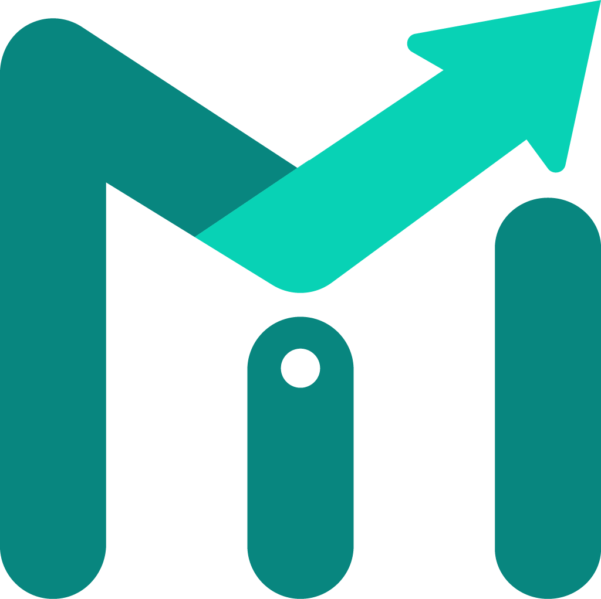
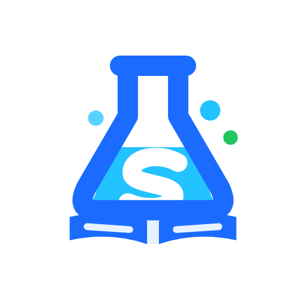
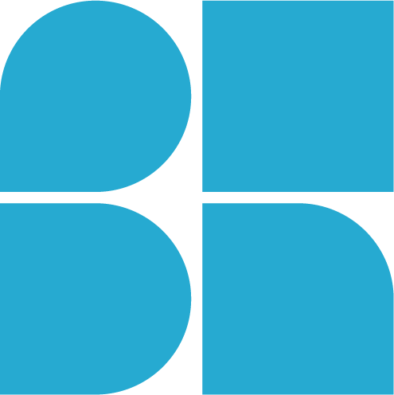
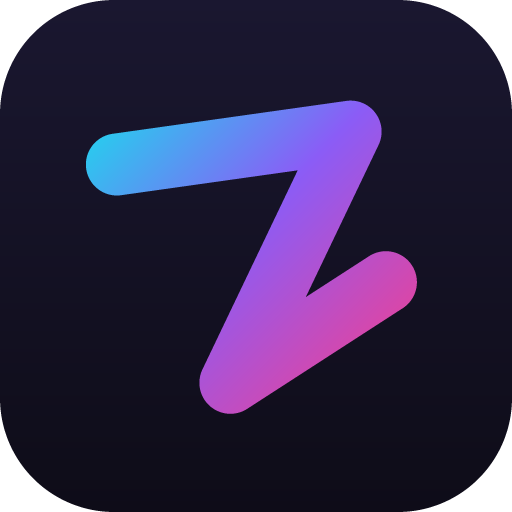

<div align="center">

# Mbah Lesky (Lespa)

<a href="https://github.com/MbahLesky">
  
</a>

<p align="center">
  <em>Architecting resilient, offline-first digital products from discovery sketch down to the final production pixel.</em>
</p>

<p align="center">
  <a href="mailto:mbahlesky4@gmail.com">
    
  </a>
  <a href="https://github.com/MbahLesky">
    
  </a>
  <a href="https://github.com/MbahLesky/lespa-portfolio">
    
  </a>
  
  
  
</p>

---

</div>

```
                            [ THE DEVSIGNER LIFECYCLE ]

   [ Figma / Adobe ] ──────> [ Design Tokens ] ──────> [ React / Next.js ]
    • Visual Hierarchy        • Spacing Matrices        • Server Components
    • Auto-Layout Parity      • Color Primitives        • Edge / SSR & SEO
    • Typographic Scale       • Expansion Tolerance     • Strict Hand-Coded UI
          │                                                    │
          └────────────────> [ Flutter / Dart ] <──────────────┘
                             • Drift SQLite Persistence
                             • Outbox Synchronization
                             • Cross-Platform iOS & Android
                                       │
                                       ▼
                       [ Supabase / Firebase / Node ]
                        • Relational PostgreSQL Schemas
                        • Realtime Event Subscriptions
                        • High-Availability Infrastructure
```

---

## 💡 The Architectural Problem I Solve

In modern software cycles, the costliest breakdowns happen during the **design-to-code handoff**:

1. **Designers** often design static mockups unaware of responsive layout constraints, DOM complexity, API latency, internationalization expansion (e.g., +20% for French), or deterministic local state.
2. **Engineers** translate those screens into functional but rigid, generic interfaces that strip away visual subtlety, accessibility standards, and the original brand intent.

### **The Devsigner Advantage**
I eliminate that boundary completely by treating **design as the visual codebase** and **code as the realized design**. 
* **One unified lifecycle:** From blank canvas discovery and token hierarchy in Figma to clean commits, automated tests, and live production deployments.
* **Zero translation loss:** Code-parity components, mathematically consistent typography, and sub-second interaction design out of the box.
* **Strictly hand-crafted:** No bloated templates, no drag-and-drop site builders. Every line of markup, styling, and business logic is engineered for longevity and speed.

---

## ⚡ Skills & Technologies

<div align="center">

  <!-- Interactive Icon Grid -->
  <a href="https://github.com/MbahLesky">
    
  </a>

</div>

<br/>

<div align="center">

| Domain | Technologies & Systems | Focus & Architectural Rigor |
| :--- | :--- | :--- |
| **📱 Mobile & Offline-First** | `Flutter` `Dart` `Drift (SQLite)` `Dexie` | Offline-first architecture, outbox queue sync, last-write-wins triggers, deterministic local caching, FCM push notifications. |
| **🌐 Modern Web & Full-Stack** | `Next.js 15` `React 19` `TypeScript` `Tailwind CSS` `Chakra UI` `Vite` | App Router, Server Components, SEO optimization, strict design token mapping, zero layout shifts, accessible DOM. |
| **⚡ Backend & Cloud Data** | `Supabase (PostgreSQL)` `Firebase` `Node.js` `Express` `PHP / MySQL` `PL/pgSQL` | Relational schema design, Row-Level Security (RLS), real-time subscriptions, edge functions, REST APIs, WhatsApp bot integrations. |
| **🎨 Design Systems & Identity** | `Figma` `Adobe Illustrator` `Photoshop` `InDesign` | Atomic component hierarchies, Auto Layout, localized expansion tolerance, scalable vector iconography, in-code CustomPainters. |

</div>

<br/>

<p align="center">
  
  
  
  
  
  
  
  
  
  
  
  
  
</p>

---

## 🚀 Systems in Production & Case Studies

Here are real-world platforms and systems I have architected and engineered:

###  [Monilog — Offline-First Financial Ledger Ecosystem](https://github.com/MbahLesky/Monilog-Web)
* **The Problem:** Financial tracking tools in emerging markets fail abruptly during network outages and volatile connectivity, causing data loss and synchronization conflicts.
* **The Solution:** A unified multi-platform finance suite engineered around an **offline-first outbox synchronization pattern**. Writes commit instantaneously to local storage and sync seamlessly upon reconnection.
* **Engineering Highlights:**
  * **Flutter Mobile App:** Local persistence with **Drift (SQLite)**, native Firebase Crashlytics & Analytics, and bi-directional Supabase sync.
  * **React Web App:** Client-side persistence via **Dexie (IndexedDB)**, Phone OTP (+E.164) authentication, and outbox staging queue.
  * **WhatsApp Assistant Bot:** Node.js/Express service pairing incoming WhatsApp messages with user accounts via phone link or 6-digit cryptographic fallbacks.
  * **Next.js Landing Platform:** Performance-tuned marketing application with zero layout shifts and high conversion architecture.

---

###  [Skuulabs — Interactive Virtual STEM Laboratory](https://github.com/MbahLesky/Skuulabs-Landing-Page)
* **The Problem:** High schools and secondary institutions across emerging regions lack expensive physical lab equipment, locking students out of practical science curricula.
* **The Solution:** An interactive virtual science laboratory enabling students to conduct Physics, Chemistry, Biology, and Mathematics experiments on mobile and web devices.
* **Engineering & Design Highlights:**
  * Interactive PhET simulation embedding coupled with custom digital recording sheets and automated scoring.
  * **Code-Rendered Brand Identity:** Brand marks and logos rendered natively in Flutter via `CustomPainter` to guarantee pixel-identical parity between launcher icons and in-app components.
  * Tokenized design system with strict light/dark adaptations and responsive card architecture.

---

###  [Bauhaven Academy & Ecosystem](https://github.com/MbahLesky/Bauhaven-Academy-Web)
* **The Problem:** Complex educational institutions need cohesive digital infrastructure—from student application review and admissions to asset management, attendance tracking, and treasury controls.
* **The Solution:** Co-founded and engineered the internal management platforms, course delivery architectures, and digital curricula driving modern tech training and design literacy.
* **Engineering Highlights:**
  * Multi-role authorization framework (Super Admin, Org Admin, Programme Manager, Reviewer, Finance, Attendance).
  * Strict Domain-Driven Design (DDD) specifications governing data residency, ERD schemas, and folder hierarchies.
  * Unified color tokens across institutional tools: Electric Blue (Admin), Vibrant Orange (Hub), and Forest Green (Finance).

---

###  [Zivybb Music Player](https://github.com/MbahLesky/Zivybb-Music-Player)
* **The Solution:** Cross-platform Flutter audio playback engine featuring offline audio caching, custom media session management, responsive waveform controls, and custom vector UI theming.

---

### Other Production Backends & Repositories
* **[Chekkam Backend](https://github.com/MbahLesky/chekkam-backend):** High-throughput backend and browser extension pairing for verification, security, and attendance validation.
* **[Taximan](https://github.com/MbahLesky/Taximan):** Mobility and transit product addressing urban transportation logistics.
* **[Lespa Portfolio](https://github.com/MbahLesky/lespa-portfolio):** Minimalist, high-performance visual portfolio showcasing full-lifecycle design-to-code implementations.

---

### 📂 Featured Repository Showcases

<div align="center">
  <a href="https://github.com/MbahLesky/Monilog-Web">
    
  </a>
  <a href="https://github.com/MbahLesky/Bauhaven-Academy-Web">
    
  </a>
</div>

<div align="center">
  <a href="https://github.com/MbahLesky/Skuulabs-Landing-Page">
    
  </a>
  <a href="https://github.com/MbahLesky/chekkam-backend">
    
  </a>
</div>

---

## 🎨 Design Engineering & Visual Philosophy

I treat visual design with the mathematical rigor of an engineer:

* **Centralized Design Tokens:** Spacing matrices, semantic elevation levels, and responsive typographic scales mapped 1:1 between Figma styles and Tailwind/Flutter configuration files.
* **Internationalization Tolerance:** Layout components are built with a mandatory **~20% expansion tolerance** (e.g., accommodating English to French text expansion) without breaking container boundaries or clipping labels.
* **Disciplined Typography:** Strict hierarchical pairings—coupling geometric grotesques like **Saira** for data-dense headlines with screen-optimized typefaces like **IBM Plex Sans** for long-form readability.
* **Direct Vector Craft:** Custom brand identity marks, iconography, and vector assets crafted in **Adobe Illustrator** and exported as clean, minified SVGs or in-code vector paths.

---

## 📊 Engineering Analytics & Activity

<div align="center">

  <!-- Profile Trophy Badges -->
  

</div>

<br/>

<div align="center">
  <!-- Core Stats -->
  
  <!-- Top Languages -->
  
</div>

<div align="center">
  <!-- Streak Stats -->
  
</div>

<br/>

<div align="center">
  <!-- Dynamic Contribution Wave Graph -->
  
</div>

---

## 🤝 Let's Build Something Exceptional

Whether you need a complete MVP engineered from scratch, an offline-first mobile client that never drops transactions, or a design system that translates seamlessly into code—I bring singular ownership to the entire process.

### **What I Can Deliver For You:**
- 📱 **End-to-End Cross-Platform Apps (Flutter & Dart):** Offline-first architecture, local SQLite persistence, seamless background sync.
- 🌐 **Modern High-Performance Web Apps (Next.js & React):** Server components, sub-second loads, tokenized responsive layouts.
- 🎨 **Figma Design Systems & Brand Identity:** Production-ready tokens, Auto-Layout component variants, and vector brand marks.
- ⚡ **Backend & Realtime Infrastructure:** Supabase/Firebase database schemas, secure authentication flows, and edge functions.

<br/>

<div align="center">

### **Ready to discuss a project, contract, or full-time role?**

[](mailto:mbahlesky4@gmail.com)
[](https://github.com/MbahLesky)
[](https://github.com/MbahLesky/lespa-portfolio)

<p align="center">
  <em>"Treat design as the visual codebase, and code as the realized design."</em>
</p>

</div>
